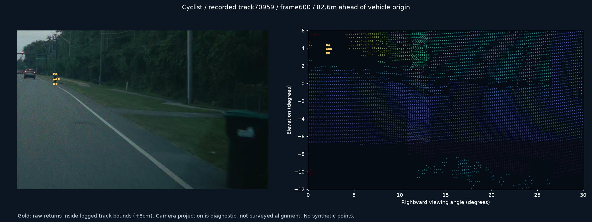
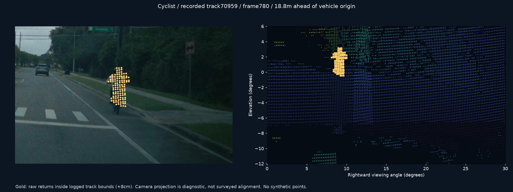
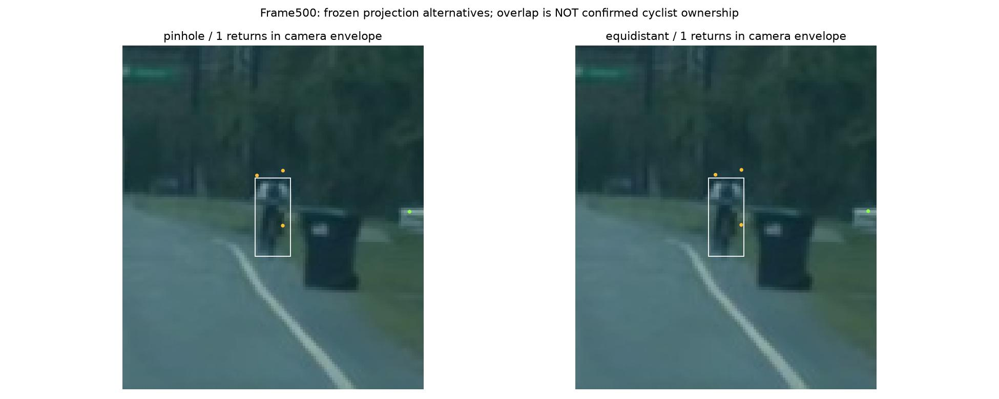

# Case01: cyclist on the right shoulder

Daylight/overcast encounter in route00000060--b12 d271 bbf, segment39. Original preview covers ordinals400–899 (25 seconds). Native video is the full segment.46 selected lidar scans are included, each630/630 packets.

The historical logged track70959 begins at94.607 m **forward of the configured vehicle origin**, with7 points. It persists13.200 seconds across100 processed rows,91 fresh measurements and9 coasting rows. This is one encounter, not measured class-specific recall. Approximately131.2 m at ordinal500 is an early candidate association; several coherent range returns around115 m appear at530. Ownership there is weaker than the established track. Do not report131 m as verified recognition or maximum range. The final0.584 m forward position is a coasting prediction, not near-field measurement proof.

The5 Hz camera pilot proposed PERSON AHEAD, BICYCLE RIGHT and PERSON RIGHT for this rider. These were virtual notices. Person/bicycle relationship history expired, and cross-camera identity evidence arrived after the duplicate. Existing code already handles one nested tentative bicycle case; a simple containment rule is not the missing solution.

Overlays use estimated projection and are not point-ownership ground truth. Raw data is available to challenge these associations.

[Download data](https://github.com/TwelveInchPianist/odyssey-lidar-samples/releases/download/review-2026-10-29/01-cyclist-data.zip) · [Technical brief](../../TECHNICAL-BRIEF.md)
