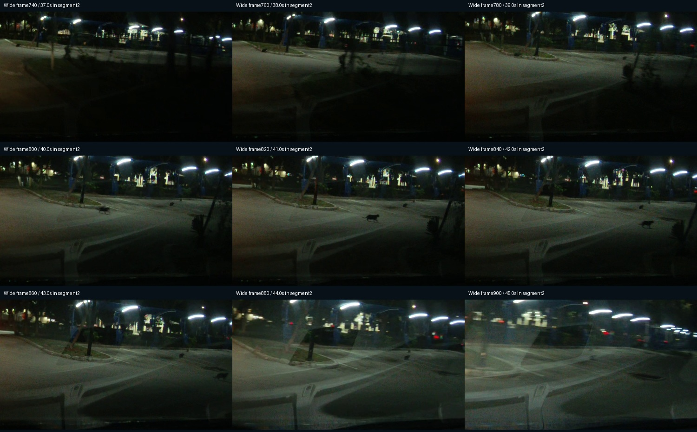
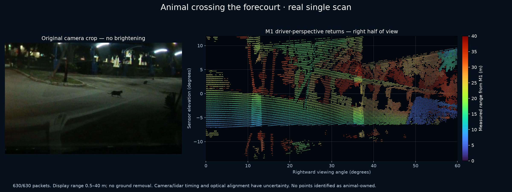

# Case02: small animal at a gas station at night

Route0000005 b--db0 d03 ba60, segment2. At least one small moving animal appears near the curb and crosses the forecourt. The driver reports cats; appearance is consistent with a cat. Do not count all dark blobs as separate animals. Native previews cover ordinals600–999 (20 seconds).12 selected raw scans,630/630 packets each, span ordinals700–900.

The baseline5 Hz camera pilot generated6 animal-class boxes but0 confirmed animal rows/advisories. YOLO11 x produced7 boxes and0 advisories. Near-native YOLO11 m also produced7 boxes and0 advisories:6 scores exceeded0.45, but the observations split into different tracks. Missing overlap association, rather than the old track already expiring, initiated several splits. A motion-prediction fallback was rejected after it incorrectly inherited identity/confidence for different actors in negative tests.

Lidar ownership is **unresolved**. At narrow770,27–28 returns inside the image envelope are mostly0–11 cm above the unverified logged ground estimate. They may be curb/road. At wide820, three frozen projection models select17/58/8 returns, with no common index across all three. Neither no animal returns nor a measured animal range has been established. The raw scans are complete; calibration, visibility and sparse small-object geometry remain possible issues.

[Download data](https://github.com/TwelveInchPianist/odyssey-lidar-samples/releases/download/review-2026-10-29/02-night-animal-data.zip) · [Technical brief](../../TECHNICAL-BRIEF.md)
