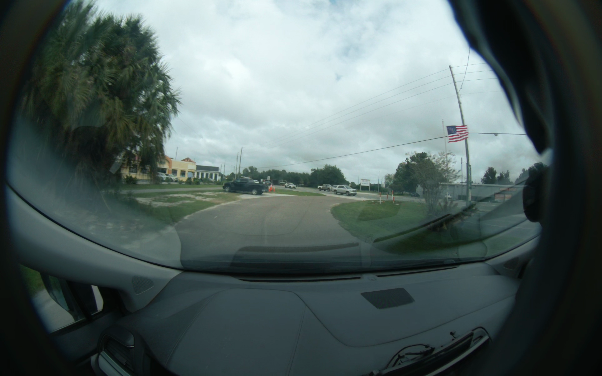
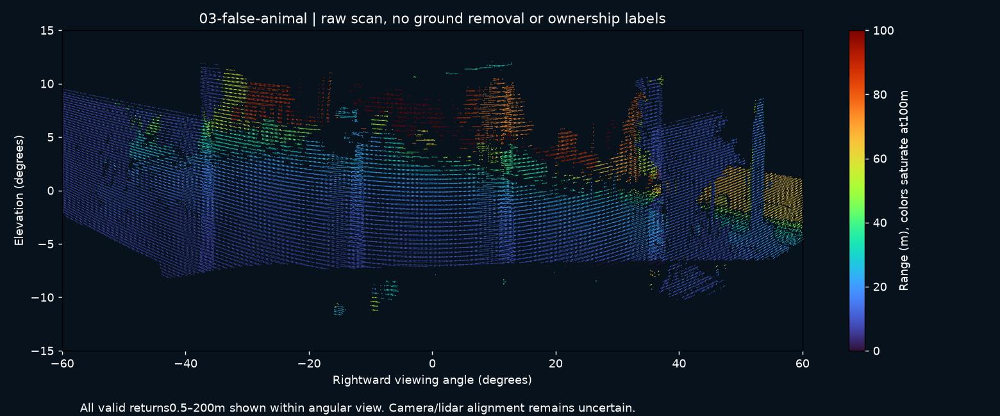

# Case03: palm foliage announced as an animal

Route0000005 d--ae6 b3 b1 b80, segment2, wide ordinal40/frame2443. The camera policy proposed ANIMAL LEFT at source178049486585622 ns, after3 supporting observations. The detector's dog score was0.799. The box[83.8,4.8,583.7,597.1] covers the standing palm foliage on the left.

This PNG was decoded from the exact original frame using the frozen native conversion and matched the saved inference-input pixel hash. This is an actual false-object proposal, unlike raw unconfirmed model hypotheses that never reach speech. Persistence and a high detector score alone did not prevent it. Do not infer that all vegetation is irrelevant: fallen branches and vegetation obstructing a road/usable shoulder are within the intended scope.

The ZIP includes the original native videos, camera indexes and5 selected complete raw lidar scans near the event. Those lidar samples were not used to claim a verified cross-sensor identity. Camera preview covers ordinals0–159 (8 seconds).

[Download data](https://github.com/TwelveInchPianist/odyssey-lidar-samples/releases/download/review-2026-10-29/03-false-animal-data.zip) · [Technical brief](../../TECHNICAL-BRIEF.md)
