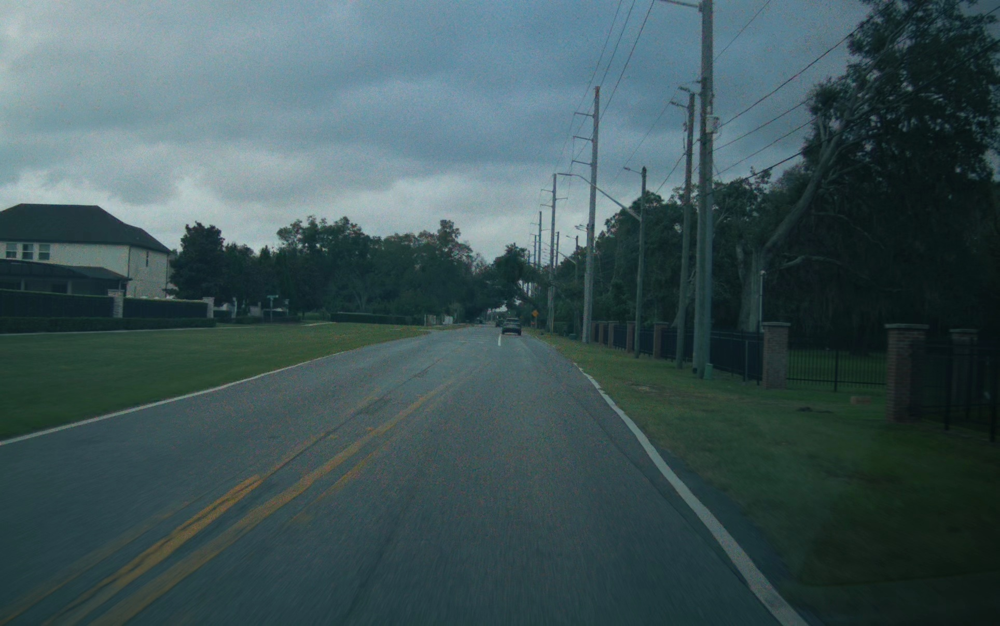
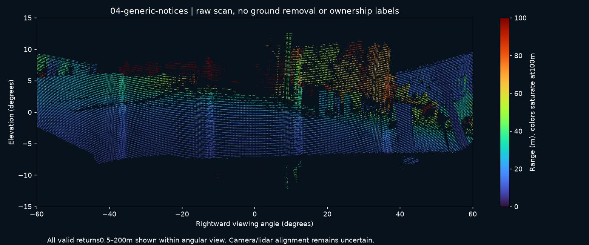

# Case04: generic lidar proposals overwhelm useful selection

The same road drive as case01 was replayed through the current shared geometric engine and presence policy in time order, with receipt-causal telemetry,30 seconds of warmup and approximately60 seconds scored.631 processed frames cover the whole run. Audio busy periods use the existing WAV durations; all delivery is virtual. Camera semantic fusion and a historical binary map are absent in this isolated diagnostic.

There were36 generic Object/Objects proposals in the scored minute,54 including warmup. **These are not36 manually adjudicated false objects**: many may be real but unhelpful scenery. A diagnostic association to the historical cyclist track within1 m matched92 rows;89 were eligible presence observations, but no cyclist-associated lidar notice was selected.

The archive contains every saved replay row, proposed event and processing-source hash, and12 representative complete raw scans across the scored minute. These samples are intentionally discontinuous. Case01 supplies the original camera segment39; its preview concentrates on the cyclist later in that minute.

The problem is evidence selection and useful announcements, not simply making all unknown objects eligible or lengthening a global cooldown.

[Download data](https://github.com/TwelveInchPianist/odyssey-lidar-samples/releases/download/review-2026-10-29/04-generic-notices-data.zip) · [Technical brief](../../TECHNICAL-BRIEF.md)
