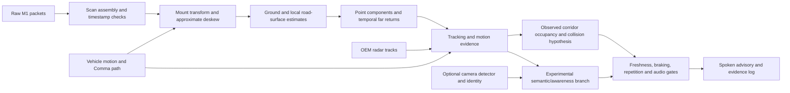

# Independent review: lidar-based collision warnings and nighttime road-user alerts

**Status date: 15 November 2026. Prepared for the owner's external Gemini/Hydrogen review.**

This document is a technical handoff, not an endorsement of the current design. The owner wants a substantial improvement in capability, not an indefinite sequence of special-case filters. Please challenge the architecture, the interpretation of the evidence, and the proposed learned-perception direction. Do not assume that prior assistant conclusions are correct.

Read this document first, then [the review questions](REVIEW-REQUEST.md), [the code map](CODE-MAP.md), and [the selected measurements](EVIDENCE.json). Current deployed-source files are in [source/](source/); hashes are in [SOURCE-MANIFEST.json](SOURCE-MANIFEST.json). [Reproducibility and access limits](REPRODUCIBILITY.md) distinguish what is actually included from locally retained evidence.

## 1. What the owner is trying to accomplish

An aftermarket, **audible-warning-only** system on a Honda Odyssey. No steering, braking, throttle commands or other vehicle control.

Two complementary goals:

1. Preserve useful geometric forward-collision warnings for walls, parked/stopped vehicles and unknown physical obstructions. The owner reports that one spoken warning helped avoid a wall while momentarily distracted. That is a valuable owner report plus a preserved replay case, not a controlled accident-prevention efficacy measurement.
2. Provide useful notice of pedestrians, cyclists, animals and relevant unknown roadside/road objects, particularly at night. A dark-clothed person on an unlit shoulder is an important desired use case. The desired recognition distance is roughly70–100m or farther where feasible, not a demonstrated capability.

Roadside presence can matter even without predicted lane entry. Conversely, ordinary trees, poles, signs, overhead structures and routine traffic should not create constant speech. A branch obstructing the road is relevant even if a standing tree beside the road is not. Construction/changed road layout can be worth one scene-level notice without announcing every marker. The owner initially accepted up to3 unhelpful notices per10 evaluated minutes, with misses reported separately. That is a preference target, not an achieved performance figure or a safety standard.

The owner prefers naturalistic driving data and small practical calibration exercises. Dangerous staged encounters, a private proving ground and surrogate targets cannot be prerequisites. Do not recommend testing by driving toward people, animals or obstacles. No ASIL certification, guaranteed uptime or reliance-grade safety validation exists.

## 2. Hardware and constraints

- Original used RoboSense M1, reported by the owner as2022-era, forward-facing in a recessed roof position. Accepted near-field blind spots. The manufacture date/hardware revision was not independently established from packet bytes.
- Recorded original-M1-compatible model byte0x10;630 packets/scan,10Hz, strongest single return in the sampled audit. Curved/nonuniform angular sampling, not a uniform image grid. Sensor clock was not PTP-synchronized in those samples.
- An angular-pattern audit of150 complete scans did not show a broad doubled-density horizon band. It did **not** read an authoritative ROI-enable bit or prove that a particular optional scanning mode was disabled. No successful ROI/super-resolution enablement is established.
- Comma3X narrow/wide forward cameras, native20fps recordings, IMU and vehicle telemetry. OEM-radar-derived tracks are available; these are not raw imaging-radar measurements.
- Live platform: Lenovo Legion Go, AMD Z1 Extreme,16GB RAM, Windows11, usually a reported65W USB-C PD supply. Real power interruptions have occurred; app availability and vehicle power availability must be distinguished.
- Offline resources: MacBook Pro with48GB memory, Mac Mini, and Ryzen7900X desktop. CUDA-dependent 3D frameworks are not automatically executable on Apple MPS or AMD DirectML. Existing CPU inference is possible for one older 3D model; real-time neural3D deployment is not demonstrated.
- Existing short two-worker camera benchmark: MacBook mean95.94s versus Mini130.29s for1,440 sampled images, about1.36× throughput. That is not a full-stack speed ratio; counts matched, not bit-identical boxes/scores. Other local workloads can contend for these machines.

## 3. What is actually deployed

**0.9.17-ground-repeat**, installed and qualified on the tablet on November14. The separate Windows scheduling repair described below was applied afterward without changing the perception release.

The current live geometric pipeline is predominantly CPU/NumPy/SciPy, using an isolated inference child process. The optional camera branch uses a YOLO11m FP32 ONNX model on DirectML. GPU support does not mean the lidar engine is GPU-accelerated, nor that every road recording had live camera perception enabled. The latest fully reviewed road capture ran0.9.16 with nighttime awareness **off**. Installation preserved existing settings. There is no subsequent on-road validation of0.9.17 established by this handoff.

The diagram describes logical components, not a claim that all fusion branches are active or equally validated. Read their eligibility gates and settings in source.

### Core behavior and assumptions

- Mount/physical alignment is provisional in the forced experimental mode. The software exposes that bypass instead of treating it as calibrated truth.
- Ground fitting uses bounded-height low-envelope cells, RANSAC-style hypotheses, plane coverage/residual checks and temporal settling. Connected local road patches address some grade transitions. A single broad plane remains a problematic global readiness dependency.
- Clustering and tracking retain raw membership, current observations, ego-motion compensation, ambiguity and motion evidence. Track identity changes and geometry fragmentation are recurring issues. Unknown motion must not automatically become confirmed stationary or crossing motion.
- Geometric FCW considers predicted swept-path overlap, current return occupancy, TTC hypotheses, measured braking and warning repetition. A transient point cluster or unverified TTC is not an established physical collision forecast.
- The forced route can use a Comma model path, lane midline, a historical route continuation, or provisional vehicle-motion extrapolation. Their uncertainty and future driver maneuvers complicate nuisance classification.
- Freshness limits are separate from process liveness: late inference can be recovered without allowing stale speech. Keeping a child alive is not permission to use expired detections.
- Optional camera identity work is bounded/asynchronous so it cannot indefinitely block primary detections. Camera failure must not disable the geometric warning path.

## 4. Recent deployment improvements and their measured scope

### Recovery, launch and sleep

Earlier inference-child failures could exhaust a small restart allowance. Recovery was changed to continue bounded retries with backoff, distinguish late replies from hung children, discard stale outputs and clean up owned processes. Synthetic packaged tests exercise recovery, stale-alert rejection and hung-child cleanup; they do not prove continuous road uptime.

The Windows launch/window problem, orphaned diagnostic processes, console-window clutter and sleep/wake behavior were investigated separately. The app now has a larger driver display, a direct Comma-hotspot connection control and a sleep slider. The owner reported that the revised sleep/wake behavior seemed to work. A native sleep request had previously entered a deeper state; the revised policy keeps the app lifecycle intact through the intended screen-off/standby flow. A measured one-second wake guarantee is not established.

At0.9.17 installation, initial scheduled launch to verified visible driver window took8.13s and a clean relaunch2.81s. These include scheduling, integrity checking and UI confirmation, not a controlled cold-boot benchmark. Configuration and originals were preserved. Heavy post-drive analysis is offloaded; bounded calibration work while idle remains allowed.

### Fresh-road recovery

The deployed change retains a recent settled-road reference **only for comparison**, bounded by0.75s,5m travel and5degrees of turning. Recovery still requires a fresh successful fit, agreement within8cm at fixed near-road probes, and at least65% near-road support for both estimates. It never substitutes an old plane for a new measurement. Changed/absent ground, stale/incomplete data and other invalid conditions still block or reset.

Across17 selected fresh raw windows, with overlap deduplicated and two seconds of cold start excluded, moving ground-settling time fell15.50→11.90s, restoring3.60s of eligibility with no new unavailable time in that comparison. This is about23% less settling **in those windows**, not a23% full-drive reliability improvement. Physical ground truth remains incomplete.

### Repeated surface warning

The deployed change briefly retains the ego-compensated footprint of an already warned, motion-supported stationary shallow-edge surface. A replacement ID with close overlapping geometry can be treated as a repeat for at most3s. Concurrent fresh tracks, deeper intrusion, trusted moving/oncoming candidates, direction change and unhealthy input prevent that suppression. Review whether this association is sufficiently conservative: a different nearby object could otherwise inherit speech history.

The second right-side warning at a junction,1.60s after the first, was removed. The other eight actual logged warnings retained their original replay timestamps. Exact physical point ownership is not proved merely by geometric overlap.

### Positive control preservation and target runtime

| Recorded positive | Candidate result on tablet under actual150ms deadline |
|---|---|
| Wall | Same alert frame; range12.26m; TTC1.961s; roundtrip median40.2ms,p9594.6ms;0 late frames/124 |
| Parked car | Same alert frame; range13.5m; TTC1.828s; median41.3ms,p95136.2ms;4 late frames/113 withheld |

The packaged CPU inference child, module integrity and existing native-video/DirectML camera smoke checks passed. Physical speaker output and a real road drive were not tested during deployment. These are two selected positives, not a recall benchmark.58 existing and10 new focused tests passed for that release candidate.

### Windows scheduling correction

The normal launch task and watchdog were unintentionally using BelowNormal priority; the current backend and watchdog processes confirmed it. Both launch paths and owned running processes were changed to standard Normal, with original task definitions retained and no app restart. High/Realtime priority, affinity, power plans and Defender were not changed.

A Below/Normal/Normal/Below packaged replay compared777 frames per run. Mean per-window p95 latency was7–13% lower in the Normal runs. However, Normal had one210.6ms deadline failure among1,554 frames, versus zero for BelowNormal. **There is no demonstrated reduction in deadline-failure rate.** The largest road-recorded child delay was about830ms elapsed with47ms CPU time, suggesting waiting/off-CPU time but not proving its cause. AboveNormal versus Normal under load has been proposed, not completed.

## 5. What the recent drive review actually established

Latest reviewed drive:58/58 camera segments completed;139,132 native frames decoded and13,914 images sampled for nomination, primarily2Hz per camera. Targeted follow-up used higher cadence. Decoding all frames is not equivalent to evaluating every frame with the detector or manually reviewing every object.

The paired tablet capture contains32,186 decisions over roughly54 minutes,9 logged warning submissions, no recorded engine-failure events and no consecutive saved-decision gap exceeding1s. Engine median46.23ms,p9570.66ms,max835.42ms;42 recorded deadline overruns.

About360s were marked not-ready, but most coincided with low-speed/gear/turn conditions; they are not all software downtime. About51.26s occurred while moving without those explicit envelope gates. Ground-settling/coverage problems dominated, with overlapping timing gaps, stale scans and overruns. Defaults/stale speed values complicate the categorization. Do not sum overlapping reason counts.

All9 actual warning contexts were reviewed using54 camera stills and27 exactly matched raw scans. Several involved ordinary infrastructure, turns, landscaping or parked vehicles. The parked-van warning may be useful. None of those facts establishes a fully labeled false-positive rate. Two additional motorcycle contexts have six matched raw scans, without definitive per-object point ownership.

The camera scan produced88 track hypotheses but no class-confirmed virtual advisories. Closer review nevertheless found a walking pedestrian, a motorcycle/rider and parked motorcycles. The pedestrian preceded the tablet recording; the moving motorcycle was across an intersection while the van was stopped. These are not established imminent-collision misses, nor proof that the system has adequate road-user recall.

## 6. Important successes, failures and rejected ideas

| Case or experiment | Evidence | What it does NOT establish |
|---|---|---|
| Distant daylight cyclist | One older public case has an established track around95m forward. A separate later case has a track hypothesis beginning97.6m with3returns, strengthening during approach. | Not guaranteed range, nighttime capability, neural recognition or surveyed3D truth. Do not merge the two encounters. |
| Nighttime small animal | Visible in camera; camera identity/confirmation fragments. Raw lidar ownership against pavement/curb remains unresolved. | Not proof of animal-specific lidar returns or reliable cat/deer alerts. |
| Palm foliage | A camera animal classification persisted enough to produce an advisory. | Temporal confirmation alone does not guarantee semantic correctness. |
| Shoulder worker | Older PointPillars CPU probe placed hypotheses near closer human returns, with conflicting labels and extra nominations; farther sparse case missed. | Not reliable human classification or a quiet live detector. |
| Stopped truck | Camera-only policy could remain silent despite vehicle observations because motion/class confirmation or role information was missing. Generic lidar proposals could notice it amid excessive chatter. | Neither camera-only silence nor generic presence is a complete useful solution. |
| Generic awareness ablations | Tens of proposals per minute in some selected windows; a coupled prototype produced19–79 proposals over roughly1–2minute windows. | Proposal counts are not physical audio or adjudicated false positives. |
| Higher cadence | A known pedestrian case fragmented at2Hz and recovered at higher rates; at native cadence another-camera repeat followed2.65s later. | More frames alone do not solve shared identity or duplicate speech. |
| ROI camera confirmation | Saved-image components could recover a worker; more realistic native-video plus FCW runs did not establish a delivered advisory. | Do not promote a component pass to integrated live success. |
| Image hashing optimization | Removing an unused per-frame diagnostic tensor hash saved a median13.29ms in20alternating same-image tablet pairs with identical detections. | That candidate result does not certify the final integrated ROI branch or whole-stack throughput. |
| Shallow-body persistence gate | Quieter in one context but delayed two warnings by0.1–0.2s; did not itself solve the repeat. Rejected. | Fewer notices is not enough to justify deployment. |
| Minimum body-point veto | Removed two further infrastructure-context notices but suppressed a synthetic object genuinely clipping the body edge. Rejected. | Broad wall/car controls alone would have missed the regression. |
| Equal near/far ground-fit weighting | Some development improvement; reserved ground windows worsened58→66 settling frames. Rejected. | Better aggregate/development numbers do not establish robustness. |

Owner Yes/No notice labels are useful relevance preferences, **not** object-class truth or3D boxes. A real rider marked No must not become a negative person label. The construction preference concerned the changed layout as a whole.

One historical replay bug retained a speech-busy timestamp across route clock resets and falsely created silence. Corrected policy-only replay changed15→16 events without repeating neural inference. Evaluate causal clocks, source age, simulated delivery and route/epoch resets before interpreting quietness.

## 7. Timing, geometry and sensing limits

The camera–lidar extrinsics, wide-lens model and physical timing are not fully qualified. Some alternative wide projection models disagree materially. A host receipt-time match, encoded frame-end timestamp or estimated clock bound is not independently measured photon/laser timing. Provisional diagnostic overlays must not be promoted to ground truth.

One audit comparing current warning points to later odometry found that seven of nine contexts had positive provisional clearance under the later path. This cannot be used as an online veto: later motion is unavailable at warning time, the driver may react, and the mount/motion assumptions are uncertain. The current path and instantaneous vehicle-motion projection agreed within about0.23m at one second across those cases, so no simple current-path sign bug was established.

Lidar's illumination is independent of visible ambient light, but target reflectivity, range, beam sampling, occlusion, mounting, contamination and geometry still matter. A few returns can support object presence without enough shape information to distinguish a person from furniture. A model cannot manufacture information absent from the measurements.

## 8. Learned3D perception: actual status

An existing offline Open3D-ML v0.19 PointPillars/KITTI checkpoint runs unchanged on desktop WSL CPU. It supports Pedestrian/Cyclist/Car and uses x range0–69.12m. The small worker probe demonstrated some grouping value and class confusion, not deployment readiness. Linear M1 intensity/255 and a recorded mount rotation were provisional encoding choices, not verified sensor-domain equivalence.

A research contact offered an original-M1 SenseBike CenterPoint bundle trained using pseudo-labels; the described results were better for cars than bikes, without human labels. **The bundle has not been obtained or tested here.** Its SharePoint location blocks external sharing. A one-time owner-authorized request for an alternative link was sent; no further outreach is authorized. Do not treat an empty desktop folder or prepared input scans as a completed model evaluation.

A new [Autoware discussion reply](https://github.com/autowarefoundation/autoware/discussions/7377#discussioncomment-19627895) identifies a concrete preprocessing issue. The cited [example configuration](https://github.com/autowarefoundation/autoware_universe/blob/502994b9e56d95d615200ba8d3cfe0a31de37018/perception/autoware_lidar_centerpoint/config/ml_package.param.yaml) has x/y limits±76.8m and no animal class. This is a published configuration fact, not a diagnosis of our custom deployed engine or the still-unavailable SenseBike checkpoint. Radial distance, forward x and coordinate origins must not be conflated.

Nine full decoded scans from the later cyclist approach, approximately98→20m in tracked forward position, were recovered with raw-packet hash/quality checks. A preliminary crop audit is ready. One selected frame has no unambiguous saved current-point ownership for the target; that is unavailable association, not target absence. No new SenseBike inference has run. Changing an input range is not assumed compatible with exported tensor/grid dimensions or training coverage.

## 9. The proposed step change — a hypothesis to review

The latest proposal is to adapt a pretrained3D detector to the actual M1 installation and use learned object/scene evidence alongside independent geometric FCW. The owner is dissatisfied with gradual suppression-rule tuning. This proposal is not yet a demonstrated upgrade.

Please compare it against alternatives: better camera-led semantics with lidar metric support; temporal lidar occupancy/scene understanding; fewer, stronger geometric components; and, if hardware changes are justified, thermal sensing for nighttime semantic evidence. Do not present thermal range guarantees without camera/optics/mount details. No hardware purchase or paid training service has been authorized.

Any learned direction needs explicit class scope, sensor-frame preprocessing, domain adaptation, object/temporal labels distinct from preference labels, held-out evaluation and a viable target runtime. Apple's memory capacity alone does not resolve CUDA-only operators. A larger model is not automatically better for sparse returns or late observations. An animal-free label set is not an animal-warning solution.

## 10. Evaluation infrastructure and access

The local reusable acceptance suite freezes17fresh and5older raw windows, exact wall/parked-car/parked-van positives, an edge-clipping counterexample and stale/incomplete/time-invalid input gates. It hashes source/metadata/baseline traces, reports deduplicated not-ready/settling time and can reuse an exact baseline rather than recompute it. Its pedestrian/cyclist/animal artifacts are currently review controls, not automated recall assertions. Passing it is limited regression evidence, not permission to claim safety certification.

A synchronized replay tool now supports saved routes, narrow/wide views, a forward/driver-perspective point cloud, optional overhead view, scrubbing and frame stepping.25 checks cover packet/index consistency, exact extracted point agreement, camera decode agreement and seek behavior. Physical alignment uncertainty remains visible. It is an offline inspection tool, not live sensor fusion.

Existing public sample cases remain available: [daylight cyclist](../../cases/01-cyclist/README.md), [night animal](../../cases/02-night-animal/README.md), [false animal](../../cases/03-false-animal/README.md), [generic notices](../../cases/04-generic-notices/README.md). These precede the current release and must not be scored as current outputs without replaying it. Newer raw replay packs remain local; this handoff publishes selected measurements and source, not the complete corpus. Credentials, device-access configuration, unrelated personal/legal material and private correspondence are excluded. The development repository remains private.

## 11. What a useful independent review should deliver

Give a candid architecture verdict and rank the next three concrete experiments. Identify what to stop building. Separate sensing limitations from calibration, preprocessing, detection, identity, path/relevance policy, scheduling and audio failures. Cite exact source functions or included measurements for criticisms. Mark hypotheses and missing evidence explicitly.

Propose a bounded, substantial improvement with acceptance and abandonment criteria, required labels, actual compute dependencies and deployment risks. Explain how it preserves unknown-obstacle FCW while improving useful nighttime road-user notices. Please do not return only a generic recommendation to gather more data, use a larger model, add an occupancy network or improve evaluation methodology without specifying the mechanism and decisive test.
