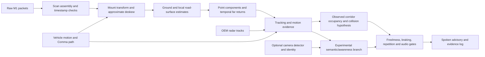

## 3. What is actually deployed

**0.9.17-ground-repeat**, installed and qualified on the tablet on November14. The separate Windows scheduling repair described below was applied afterward without changing the perception release.

The current live geometric pipeline is predominantly CPU/NumPy/SciPy, using an isolated inference child process. The optional camera branch uses a YOLO11m FP32 ONNX model on DirectML. GPU support does not mean the lidar engine is GPU-accelerated, nor that every road recording had live camera perception enabled. The latest fully reviewed road capture ran0.9.16 with nighttime awareness **off**. Installation preserved existing settings. There is no subsequent on-road validation of0.9.17 established by this handoff.

The diagram describes logical components, not a claim that all fusion branches are active or equally validated. Read their eligibility gates and settings in source.

### Core behavior and assumptions

- Mount/physical alignment is provisional in the forced experimental mode. The software exposes that bypass instead of treating it as calibrated truth.
- Ground fitting uses bounded-height low-envelope cells, RANSAC-style hypotheses, plane coverage/residual checks and temporal settling. Connected local road patches address some grade transitions. A single broad plane remains a problematic global readiness dependency.
- Clustering and tracking retain raw membership, current observations, ego-motion compensation, ambiguity and motion evidence. Track identity changes and geometry fragmentation are recurring issues. Unknown motion must not automatically become confirmed stationary or crossing motion.
- Geometric FCW considers predicted swept-path overlap, current return occupancy, TTC hypotheses, measured braking and warning repetition. A transient point cluster or unverified TTC is not an established physical collision forecast.
- The forced route can use a Comma model path, lane midline, a historical route continuation, or provisional vehicle-motion extrapolation. Their uncertainty and future driver maneuvers complicate nuisance classification.
- Freshness limits are separate from process liveness: late inference can be recovered without allowing stale speech. Keeping a child alive is not permission to use expired detections.
- Optional camera identity work is bounded/asynchronous so it cannot indefinitely block primary detections. Camera failure must not disable the geometric warning path.
